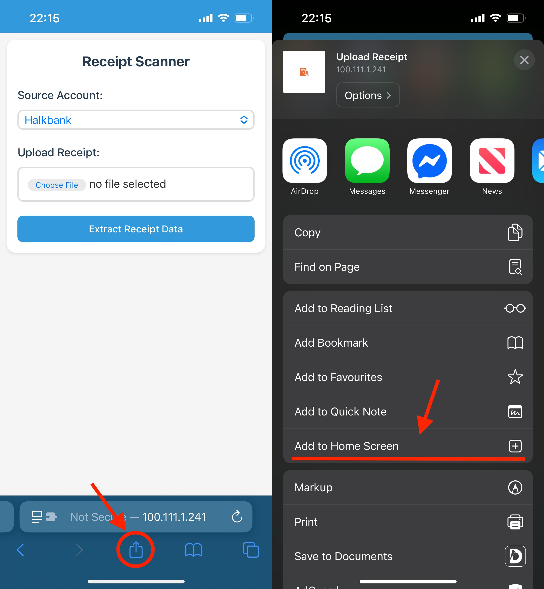

# Receipt Scanner for Firefly III

A web application that allows you to scan receipts and automatically create transactions in Firefly III.

## Demo

Check out the demo video below to see the Receipt Scanner in action:


https://github.com/user-attachments/assets/ec41d8dc-71e9-4aa4-b65c-869c3dd54845

## Features

- Upload and scan receipts using Google's Gemini AI
- Extract key information: date, amount, store name, category, and budget
- Review and edit extracted data before creating transactions
- Create transactions in Firefly III with a single click
- Automatically adds an `#automated` tag to all created transactions
- Mobile-friendly interface for scanning receipts on the go

## Prerequisites

- Docker and Docker Compose
- A Firefly III instance
- A Google AI API key

## Configuration

1. Clone this repository:
   ```
   git clone https://github.com/yourusername/receipt-scanner.git
   cd receipt-scanner
   ```

2. Create a `.env` file based on the `.env.example`:
   ```
   cp .env.example .env
   ```

3. Edit the `.env` file with your configuration:
   ```
   # Firefly III API Configuration
   FIREFLY_III_URL=https://your-firefly-iii-instance.com
   FIREFLY_III_TOKEN=your-personal-access-token

   # Google AI API Configuration
   GOOGLE_AI_API_KEY=your-google-ai-api-key
   GEMINI_MODEL=gemini-2.5-flash
   ```
   
### Requesting Firefly III Token

   To use this application, you'll need a personal access token for Firefly III. Follow the instructions in the official documentation to generate one: [Firefly III API - Personal Access Tokens](https://docs.firefly-iii.org/how-to/firefly-iii/features/api/#personal-access-tokens)

### Requesting a Gemini API Key
   To use Google's Gemini AI, you'll need an API key. Visit the following URL to request one: [https://aistudio.google.com/apikey](https://aistudio.google.com/apikey)

   You will be asked to enter a credit card for verification purposes, but personal usage will most likely fall within the free tier.

### Gemini Model

   The `GEMINI_MODEL` environment variable controls which Gemini model is used for receipt scanning. The recommended default is `gemini-2.5-flash`, which offers a good balance of speed and accuracy. You can change this to any supported Gemini model (e.g. `gemini-2.5-pro` for higher accuracy). See the full list of available models at [Google AI models](https://ai.google.dev/gemini-api/docs/models).

## Deployment
### Security and Deployment Considerations

This application does not include built-in authentication. It is recommended to deploy it within your local network, ideally alongside your Firefly III instance. To securely access the application remotely, consider using a VPN to connect to your local network.

### Using Docker Compose (Recommended)

`docker-compose.yml` pulls a published image from [GHCR](https://github.com/becutandavid/firefly-receipt-scanner/pkgs/container/firefly-receipt-scanner) rather than building locally, so starting (and later updating) the app is just a pull away.

1. Start the application:
   ```
   docker-compose up -d
   ```

2. Access the application at http://localhost:8000

By default this tracks the `latest` tag. To pin to a specific release instead (recommended for anything beyond casual/local use), edit the `image:` line in `docker-compose.yml` to a specific version, e.g. `ghcr.io/becutandavid/firefly-receipt-scanner:v0.1.0`. See the [Releases page](https://github.com/becutandavid/firefly-receipt-scanner/releases) for available versions and what changed in each.

If you'd rather build the image yourself from source (e.g. for local development), comment out the `image:` line in `docker-compose.yml` and uncomment `build: .`.

### Manual Deployment

1. Install the required dependencies with [uv](https://docs.astral.sh/uv/):
   ```
   uv sync --frozen
   ```

2. Run the application:
   ```
   uv run uvicorn app.app:app --host 0.0.0.0 --port 8000
   ```

## Usage
   1. Open the application in your web browser
   2. Select a source account from the dropdown menu
   3. Use the camera to take a photo of your receipt
   4. Review and edit the extracted data
   5. Click "Create Transaction" to create the transaction in Firefly III

If you're using a phone, consider adding a bookmark of the app to your home screen for easier access.



## Updating

Since `docker-compose.yml` pulls a published image, updating no longer requires rebuilding from source:

1. Check the [Releases page](https://github.com/becutandavid/firefly-receipt-scanner/releases) for what changed, and whether any new environment variables were added to `.env.example` that you should add to your own `.env`.

2. Pull the new image and restart the container:
   ```
   docker-compose pull
   docker-compose up -d
   ```

Your `.env` file will not be affected by the update. If you're pinned to a specific version tag (see above), bump that tag in `docker-compose.yml` before pulling.

If you're running from a locally built image (`build: .`), the old flow still applies: `git pull`, then `docker-compose up -d --build`.

## Troubleshooting

### Common Issues

- **Image Processing Timeout**: If you receive a timeout error when processing an image, try using a clearer image with better lighting and less glare.
- **Transaction Creation Failed**: If transaction creation fails, check your Firefly III connection and ensure your API token has the necessary permissions.
- **Camera Not Working**: Ensure your browser has permission to access your camera. For mobile devices, you may need to use HTTPS.

## Development

### Project Structure

- `app/` - Application code
  - `app.py` - FastAPI application and routes
  - `firefly.py` - Firefly III API integration
  - `receipt_processing.py` - Receipt data extraction and processing
  - `image_utils.py` - Image processing utilities
  - `models.py` - Data models
  - `templates/` - HTML templates
  - `static/` - Static assets (CSS, JavaScript)


## Contributing

Contributions are welcome! Please feel free to submit a Pull Request.

## License

MIT
